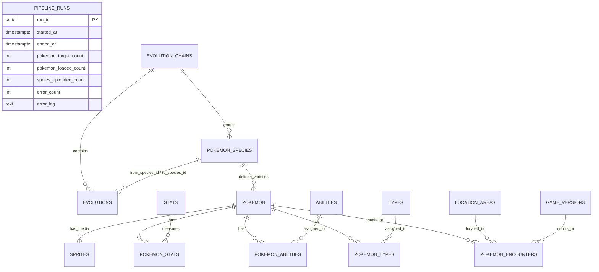

# PokéAPI Threaded Data Pipeline & Local Pokédex Agent

An end-to-end, multi-threaded Python ETL pipeline that extracts Pokémon data from PokéAPI, normalizes nested JSON into a **Third Normal Form (3NF)** PostgreSQL database, archives static PNG and animated GIF sprites to **Google Cloud Storage (GCS)**, and serves a local **Qwen + Google ADK** Pokédex agent.

---

## 1. Entity-Relationship Diagram (3NF Data Model)

---

## 2. Design Review Questions & Architectural Defense

### Q1. A Pokémon has one or two types and up to three abilities, one of them hidden. Where do `slot` and `is_hidden` live, and why there?
* **Answer:** `slot` lives in the `pokemon_types` and `pokemon_abilities` junction tables, and `is_hidden` lives in the `pokemon_abilities` junction table.
* **Why (3NF Justification):** Neither `slot` nor `is_hidden` is an intrinsic property of a Type or an Ability itself, nor can they be stored as an array on `pokemon`. For example, the ability *Chlorophyll* is a hidden ability (`is_hidden = TRUE`, `slot = 3`) on Bulbasaur, but could be a standard ability (`is_hidden = FALSE`, `slot = 1`) on another Pokémon. Therefore, `slot` and `is_hidden` depend on the **composite key** `(pokemon_id, ability_id/type_id)` and must live on the many-to-many relationship table to satisfy Third Normal Form (3NF).

### Q2. Pikachu’s chain includes Pichu (#172), which is outside your 50. Do you load it, store a reference, or skip it? What happens to your foreign keys?
* **Answer:** We load **all species referenced in any extracted evolution chain** into the `pokemon_species` table (including baby/later-generation evolutions like Pichu `#172`, Crobat `#169`, or Bellossom `#182`), while keeping the `pokemon` table strictly restricted to the configured target slice (`#1` to `#50`).
* **What happens to Foreign Keys:** Because `evolutions.from_species_id` and `evolutions.to_species_id` reference `pokemon_species(species_id)` rather than `pokemon(pokemon_id)`, every foreign key constraint remains 100% enforced and valid without orphan references, and our Step 2 agent can accurately report the full evolution chain of Pikachu (`Pichu -> Pikachu -> Raichu`) and Oddish (`Oddish -> Gloom -> Vileplume / Bellossom`).

### Q3. Oddish’s chain branches. How does your design represent a branch?
* **Answer:** The `evolutions` table models the evolution tree as a directed **adjacency list** of edges: `(from_species_id, to_species_id)` is the composite Primary Key.
* **How branching works:** In Oddish's chain, Oddish (`43`) evolves into Gloom (`44`), which branches into Vileplume (`45`, via Leaf Stone) and Bellossom (`182`, via Sun Stone). This is represented as two distinct rows in `evolutions` sharing `from_species_id = 44`, one with `to_species_id = 45` and one with `to_species_id = 182`. No arrays or self-referencing columns on `pokemon` are needed.

### Q4. How does each table avoid duplicates when the pipeline runs twice?
* **Answer:**
  1. **Natural Keys:** Lookup and entity tables (`pokemon`, `pokemon_species`, `types`, `abilities`, `stats`, `location_areas`, `game_versions`, `evolution_chains`) use PokéAPI's stable natural integer IDs as Primary Keys plus `UNIQUE` constraints on `name`.
  2. **Composite Primary Keys:** Relationship tables (`pokemon_types`, `pokemon_abilities`, `pokemon_stats`, `evolutions`, `pokemon_encounters`) use composite Primary Keys across their foreign keys, and `sprites` enforces `UNIQUE (pokemon_id, sprite_kind)`.
  3. **Idempotent Upserts:** All database writes use parameterized PostgreSQL `INSERT ... ON CONFLICT (...) DO UPDATE / DO NOTHING`, and GCS uploads verify existing object MD5 checksums before uploading. Re-running the pipeline produces zero duplicate rows or redundant uploads.

### Q5. Which columns can be `NULL`, and why?
* `pokemon_species.habitat`: PokéAPI returns `null` for `habitat` on certain species (especially later-generation species referenced in evolution chains).
* `abilities.effect_text`: Nullable in case an ability lacks an English (`en`) effect entry in PokéAPI.
* `evolutions.min_level` and `evolutions.item_name`: Mutually independent evolution triggers—stone or trade evolutions do not have a `min_level`, while level-up evolutions do not require an `item_name`.
* `sprites.source_url`, `sprites.gcs_uri`, `sprites.content_type`, `sprites.size_bytes`, `sprites.checksum_md5`: When PokéAPI returns `null` for a sprite URL, the pipeline records the sprite row with `is_missing = TRUE` and leaves the storage metadata columns `NULL` rather than failing the run.
* `pipeline_runs.ended_at` and `pipeline_runs.error_log`: `ended_at` is `NULL` while a run is actively executing; `error_log` is `NULL` when a run completes with 0 errors.

---

## 3. Foreign Key Load Order
To guarantee foreign key integrity without disabling constraints, `pipeline/loader.py` inserts data inside transactions in this exact topological order:
1. `pipeline_runs` (initializes audit record)
2. `evolution_chains` (no FKs)
3. `pokemon_species` (FK $\rightarrow$ `evolution_chains`)
4. `pokemon` (FK $\rightarrow$ `pokemon_species`)
5. `types`, `abilities`, `stats`, `location_areas`, `game_versions` (independent dimension tables)
6. `pokemon_types`, `pokemon_abilities`, `pokemon_stats` (FKs $\rightarrow$ `pokemon` and dimensions)
7. `evolutions` (FKs $\rightarrow$ `evolution_chains`, `pokemon_species`)
8. `pokemon_encounters` (FKs $\rightarrow$ `pokemon`, `location_areas`, `game_versions`)
9. `sprites` (FK $\rightarrow$ `pokemon`)

---

## 4. Threading & Concurrency Safety
* **No Async:** Uses only `concurrent.futures.ThreadPoolExecutor`, `threading.Lock`, and `threading.local`.
* **Thread-Local Clients:** Both `requests.Session` and `google.cloud.storage.Client` are stored in `threading.local()` so worker threads never share non-thread-safe network/storage clients.
* **Lock-Protected Shared State:** Shared sets tracking already-scheduled/fetched URLs (`seen_type_ids`, `seen_ability_ids`, `seen_chain_ids`, `seen_species_ids`) and run counters are guarded by `threading.Lock()`. Without this lock, two worker threads processing two Grass-type Pokémon simultaneously could check `if type_id not in seen_type_ids` at the exact same instant (a classic check-then-act **race condition**), causing duplicate HTTP requests and concurrent writes to the same local cache file.
